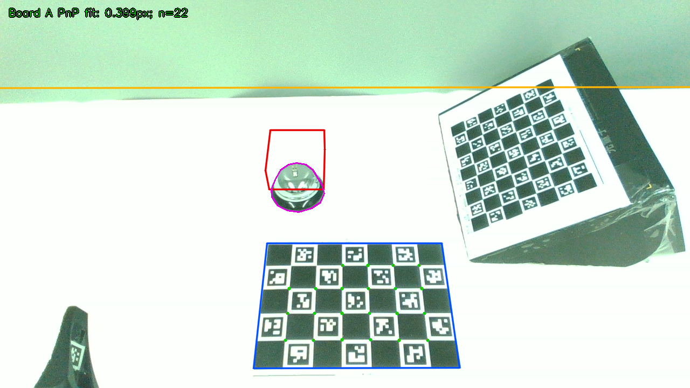

# 从真实 RGB 重新求位姿的工作台

通用工具已经完成两张 resume10 头部 RGB → 板 A 检测 → head_pnp → USD →
scene package → 叠加图的完整离线链。板 A 拟合 RMS 为 0.399／0.394 px。
**铃的旧尺量位置与这次照片不一致，整个场景没有获得独立几何验收。**

## 复现

在仓库根目录安装依赖后，使用新输出目录：

```bash
python examples/piper_rgb_workcell_20261026/prepare_inputs.py
rp-workcell --measurements examples/piper_rgb_workcell_20261026/inputs/measurements.json --out fresh_scene
rp-real2sim2real validate --check-files fresh_scene/manifest.json
python examples/piper_clickbell_workcell_20261025/build_scene.py --out fresh_legacy_scene
python tools/workcell/compare_intact.py --intact /path/to/INTACT-data-generation --scene fresh_scene --legacy-scene fresh_legacy_scene --out fresh_comparison.json
python tools/workcell/test_workcell.py
```

新用户直接填写[通用量测模板](../../tools/workcell/README.md)，无需 INTACT、
旧 registration 或本案例的 `prepare_inputs.py`；后者仅记录本次历史尺量的提取方法。
`compare_intact.py` 仅读取 INTACT profile 并调用 `apply_scene`，不运行数采或真机。

## 输入证据

两张图固定取自 H20-96-3 的既有目录
`/data/wqz/piper-recalib-real-20261024/resume10_20261025/raw/head_rgb_gate_20261025_213538/`
中的 `head_0.png`、`head_1.png`，只下载这两张小图与 `SUMMARY.json`。
`inputs/capture_summary.json` 保留采集记录；原记录注明无运动命令、无曝光写入、
深度缺失，仅使用 RGB。本轮未接触 Piper、resume11 或推理进程。

沿用旧案例尺量：板 A 格长 36 mm、桌面 1800×805×30 mm、
铃 85×85×45 mm，底座中心 (37,-142) mm；没有声称本轮重新尺量。
旧 registration 桌面 z=8 mm，新例明确改为 z=0，使物理桌面与 PnP 的纸面一致。
仅第一张图标注近似铃轮廓（约 ±2 px），全部固定输入保存在 measurements 中。
照片中的板 B 和左下部件没有新尺量，未纳入本例；不能视为匹配。

## 实测结果

| 项目 | 结果 |
|---|---:|
| 两帧板 A 角点数 | 22／22 |
| 新 head_pnp 拟合 RMS | 0.398860／0.393926 px |
| 旧头部位姿＋同一组 K 的 RMS | 4.379267／4.389324 px |
| 新旧相机中心差 | 10.779／11.550 mm |
| 新旧相机旋转差 | 0.923979／0.980891° |
| 第一帧独立铃轮廓边界 RMS／P95 | 38.501／67.533 px |
| 旧案例 vs 实际 INTACT apply_scene 最大差 | 0.00005555 mm |
| 新桌面／板 A vs 现行场景，显式坐标对齐后 | 8.000000 mm |
| 单独扣除已声明的 8 mm 纸面修正后最大差 | <0.000001 mm |

完整逐点与相机对比见 [comparison.json](comparison.json)，逐帧投影见
[reprojection.json](scene/reprojection.json)。未标注第二帧铃轮廓，未给它编造分数。
桌面四角均在画幅外，只显示其投影及可见桌边，没有四角实拍真值。



## 原因与边界

现行头部外参来自冻结 profile 的 `calibration_v2.json/head_T`；
`inverse(to_nominal) @ authored_cameras.head @ GL_TO_CV` 与它数值一致。
源 calibration 追溯到 `auto_calib_20261020/resume8_20261020_162634`，
不是这次 2026-10-25 的 resume10 RGB。来源路径和哈希保存在比较 JSON。
不同会话的位姿差和板 A 重投影变差可以实测，无法仅凭这两帧断言是相机移动、
板 A 移动还是早期求解偏差。

转平矩阵来自冻结 `unified-r5.json/level_matrix`，由
`unified_chain.level_profile` 左乘 `to_nominal`，并做数值级刚体投影。
历史未转平桌面倾角约 0.800°；新工具只使用本次量测桌面法线，
不读取这张历史矩阵。比较时显式保存共同坐标变换。

铃的粗略底座中心像素 (551,366) 反投影到纸面，得到板系约
(38.663,-83.848,0) mm，相比冻结 (37,-142,0) mm 沿 y 偏约 58.152 mm。
这是“照片中摆放和旧位置不一致”的诊断，且盒子与圆铃形状也不同；
不是新的尺量位置，不用于重拟合后替换原结果。
新工具保留了这次失败，使用前应重新测量桌上物体。

## 回归范围

`tools/workcell/test_workcell.py` 用真实 RGB 验证 USD 回读投影、fx≠fy、
偏心主点、零纸板碰撞、桌面视觉／碰撞一致、输出不可覆盖、错误分辨率、
整台转平和给定资产打包，以及主流程清单不改变 USD。
另在独立远端 CPU 目录实际执行 Blender 4.5.3 的 `stage_worker export`；
该合成导出回归不计作真实房间重建成绩。结果见 `export_validation.json`。
